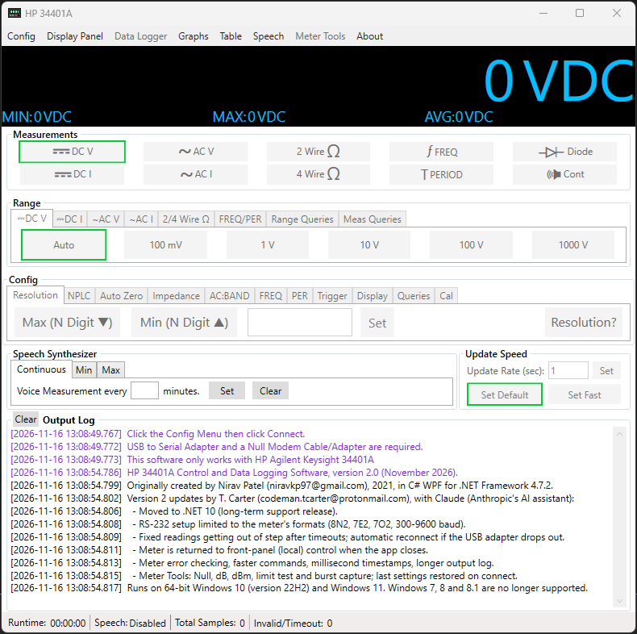
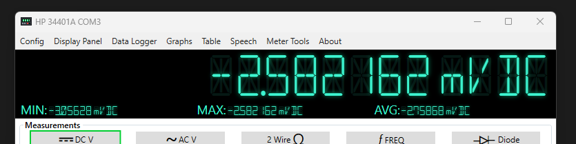

# HP 34401A Control and Data Logging Software — version 2

A Windows program that controls an **HP / Agilent / Keysight 34401A** bench multimeter over RS-232, and displays, graphs and logs its readings.

Version 2 is an updated and extended version of [Nirav Patel's original software](https://github.com/Niravk1997/HP-Agilent-Keysight-34401A-Control-and-Data-Logging-Software). It is published here with his permission.

*Optional 14-segment "VFD" display, styled after the meter's own fluorescent display:*

## Features

- **All measurement functions:** DC/AC volts, DC/AC current, 2- and 4-wire resistance, frequency, period, diode and continuity.
- **Full meter setup:** range, resolution, NPLC, auto zero, input impedance, AC filter, gate time, trigger and display text, plus query and calibration-information tabs.
- **Logging:** every reading saved with a millisecond timestamp, one file per function per day, plus a log of all commands and messages.
- **Graph window:** live plot with statistics, math (add, subtract, scale, % error, dB/dBm) and histograms; save data or images.
- **Table window** and **spoken readings** (Windows speech), including min/max alarms.
- **Meter Tools:** the meter's built-in Null, dB, dBm and limit test, and **burst capture** of up to 512 readings at full meter speed.
- **Reliable communication:** meter errors are reported as they happen, the app reconnects if a USB-serial adapter drops out, and the meter is returned to front-panel control on exit.
- **Remembers your setup:** last function, range, NPLC, auto zero, update speed, window size and display style are restored on connect.

## Requirements

| | |
| --- | --- |
| Meter | HP / Agilent / Keysight 34401A with its rear RS-232 port |
| Connection | USB-to-serial adapter and a **null-modem** cable or adapter |
| Meter settings | I/O menu: interface RS-232, language SCPI, baud 300–9600, parity None (8 bits), Even or Odd (7 bits). The meter always uses 2 stop bits. |
| PC | 64-bit Windows 10 (version 22H2) or Windows 11 |
| To build | Visual Studio 2026 with the .NET 10 SDK |

## Building and running

1. Clone or download this repository (**Code → Download ZIP** on GitHub).
2. Open `HP 34401A.sln` in Visual Studio and choose **Build → Rebuild Solution**. NuGet packages are restored automatically.
3. Press **F5**, or run `bin\Debug\net10.0-windows\HP 34401A.exe`.

To make a standalone copy, right-click the project and choose **Publish → Folder**.

## Getting started

1. **Config → Connect** opens the COM Select window.
2. Double-click your adapter's COM port, set **Bits per second** and **Parity** to match the meter, then click **Connect**.
3. Choose a function (DC V, AC V, ...) and the readings start.

The full **[User's Manual (PDF)](docs/HP%2034401A%20v2.0%20-%20User's%20Manual.pdf)** covers every window, menu and setting, plus troubleshooting.

## What's new in version 2

- Moved from .NET Framework 4.7.2 to **.NET 10**.
- RS-232 setup limited to the meter's real formats (8N2, 7E2, 7O2 at 300–9600 baud).
- Fixed readings getting out of step after timeouts; automatic reconnect; meter returned to local control on exit.
- Meter error-queue checking, faster commands, millisecond timestamps, a longer output log.
- New Meter Tools window (Null, dB, dBm, limit test, burst capture).
- Saved settings, selectable window sizes, a new icon, and an optional VFD-style display font.

See [CHANGES-v2.md](CHANGES-v2.md) for the full list.

## Credits

- **Original software:** Nirav Patel, 2021 ([original repository](https://github.com/Niravk1997/HP-Agilent-Keysight-34401A-Control-and-Data-Logging-Software)).
- **Version 2:** T. Carter (codeman.tcarter@protonmail.com), 2026, developed with Claude (Anthropic's AI assistant).
- **VFD font:** based on [DSEG](https://www.keshikan.net/fonts-e.html) by keshikan.
- Graphs use [ScottPlot](https://scottplot.net); statistics use [Math.NET Numerics](https://numerics.mathdotnet.com).

## Licence

The program is released under the [MIT License](LICENSE).

The "HP34401A VFD" font in the `Fonts` folder is a modified version of DSEG14 Classic and stays under the SIL Open Font License 1.1. See [Fonts/OFL-LICENSE.txt](Fonts/OFL-LICENSE.txt).

HP, Agilent and Keysight are trademarks of their respective owners. This project is not affiliated with or endorsed by them.
